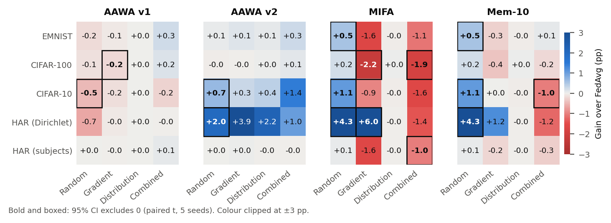
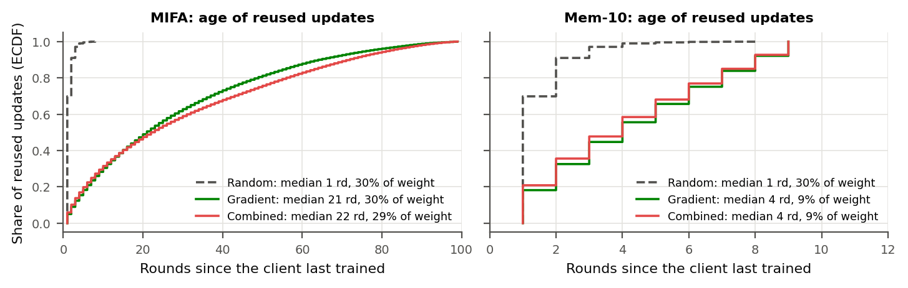
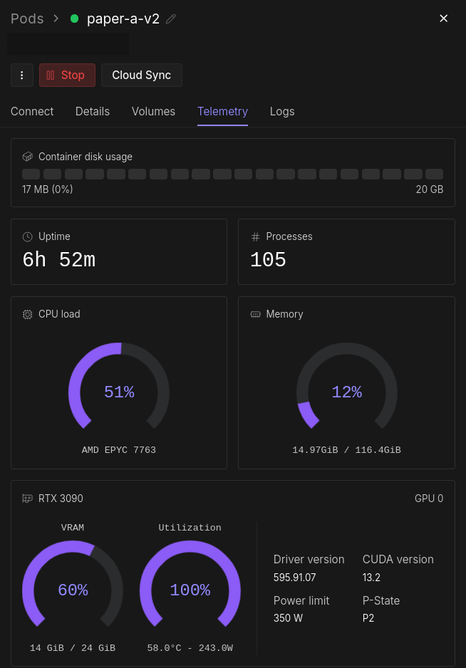

<div align="center">

# Strategic Client Silence in Federated Learning

**Absence Not at Random: a pre-registered study of what happens when an adversary chooses which clients go quiet**

[](#key-findings)
[](#citation)
[](LICENSE)
[](requirements.txt)
[](PREREG-v2.md)
[](#results-and-reproduction)
[](#how-the-study-was-run)

</div>

Federated learning treats a client that fails to report as noise. An adversary can also keep chosen clients away on purpose, by dropping their traffic or jamming their radios. The missing updates are then *missing not at random*, and the silenced clients send nothing that an update-inspecting defence could flag. This repository holds the code, the two pre-registrations, the frozen analysis and the results of a study that measures this attack and tests which server-side defences survive it.

## Key findings

- **The attack works where labels are concentrated.** Silencing chosen clients removes more accuracy than silencing random ones on EMNIST and CIFAR-100, and the gap grows with the silenced fraction (4.0 against 1.2 points at 50%). On activity-recognition data split by real subjects it has no measurable effect.
- **The average hides the damage.** The accuracy a class loses tracks the share of that class held by silenced clients (rank correlation 0.67 to 0.75), while mean accuracy falls by at most 2.4 points.
- **Reweighting the clients who remain is close to inert,** as predicted before the run.
- **Server memory turns against the server.** Reusing absent clients' last updates (MIFA) helps under random silence on all five datasets, but under strategic silence its gain is negative in 9 of 10 settings. The reused updates are 16 to 33 rounds old instead of 1, because the adversary decides how long each client stays away.
- **A short memory horizon keeps the benefit.** Capping memory at 10 rounds costs nothing under random silence and removes most of the loss under strategic silence. A small formal model of memory horizon against staleness explains when.
- **An earlier result did not replicate.** The first pre-registration failed 10 of its 14 claims, including the single-seed gain reported for the AAWA aggregator. Both phases are reported in full.

<p align="center">
  
  <br><sub>Gain of each defence over FedAvg (points) for every dataset and silence schedule, 5 seeds.</sub>
</p>

<p align="center">
  
  <br><sub>Age of the stored updates that memory aggregators reuse: about 1 round under random silence, tens of rounds when the adversary chooses who is absent.</sub>
</p>

## Repository layout

The layout mirrors the paths in the pre-registration's hash tables, so the frozen files can be checked in place.

| Path | Contents |
|---|---|
| [`PREREG.md`](PREREG.md), [`PREREG-v2.md`](PREREG-v2.md) | The first and second pre-registrations (hypotheses, thresholds, analysis plan, frozen-file hashes) |
| [`hpc-package/`](hpc-package/) | Experiment code: [`run_v2.py`](hpc-package/run_v2.py) (v2 grid runner), [`run_journal.py`](hpc-package/run_journal.py) (v1 runner and shared training), [`src/`](hpc-package/src/) (data splits, models, silence schedules, aggregators), setup and launcher scripts, smoke tests |
| [`analyze_v2.py`](analyze_v2.py), [`analyze.py`](analyze.py) | Frozen scoring scripts for v2 and v1: every pre-registered verdict |
| [`ANALYSIS-v2.md`](ANALYSIS-v2.md), [`ANALYSIS.md`](ANALYSIS.md) | Their output, regenerated from the released results |
| [`explore_v2.py`](explore_v2.py), [`results/explore_v2.txt`](results/explore_v2.txt) | Exploratory analysis (not pre-registered) and its output |
| [`plot_v2.py`](plot_v2.py), [`plot.py`](plot.py), [`figures/`](figures/) | Figure scripts and figures for v2 and v1 |
| [`make_tables.py`](make_tables.py), [`tables/`](tables/) | LaTeX tables of verdicts and exploratory gains |
| [`verify_frozen.py`](verify_frozen.py) | Checks the frozen files against the pre-registered hashes (standard library, no GPU) |

## Results and reproduction

Raw results (650 JSON files with per-round, per-class accuracy, aggregation weights, participants and silenced clients, plus logs) are attached to the [v1.0.0 release](https://github.com/ziyam-khan/research-fl-strategic-client-silence/releases/tag/v1.0.0).

```bash
git clone https://github.com/ziyam-khan/research-fl-strategic-client-silence && cd research-fl-strategic-client-silence

# 1. Check that the code matches what was pre-registered
python3 verify_frozen.py

# 2. Fetch the results (MD5 4e933eb1b90a8ca6c2329b52bf261e06) and unpack them where the scripts expect
gh release download v1.0.0 -p 'v2_results.tgz' -p 'journal_results.tgz'
md5sum v2_results.tgz
tar -xzf v2_results.tgz -C hpc-package && tar -xzf journal_results.tgz -C hpc-package

# 3. Regenerate every number (standard library only)
python3 analyze_v2.py        # pre-registered verdicts -> ANALYSIS-v2.md
python3 explore_v2.py        # exploratory analysis
python3 analyze.py           # first pre-registration -> ANALYSIS.md
python3 make_tables.py       # LaTeX tables -> tables/
python3 plot_v2.py           # figures -> figures/v2/ (needs matplotlib)
```

To re-run training, use a CUDA machine with the versions in [`requirements.txt`](requirements.txt):

```bash
cd hpc-package
bash setup_v2.sh                                   # environment check and dataset download
AAWA_DETERMINISTIC=1 python3 run_v2.py --gate      # same cell twice: must be identical
python3 run_v2.py --list                           # the 650 cells
python3 run_v2.py --claim                          # a work-queue worker; start several
```

The runner refuses to start if `PREREG-v2.md` or any frozen file differs from its approved hash.

## How the study was run

1. **First pre-registration (v1).** It tested the AAWA aggregator from an earlier conference paper with three seeds. Ten of its 14 claims failed, and two runs of the same configuration and seed finished 2.2 points apart because of non-deterministic GPU kernels.
2. **Second pre-registration (v2).** Hypotheses, thresholds, the analysis script and the experiment code were frozen by SHA-256 before any run, and amended once, also before any run. The grid has 650 cells: three image datasets (EMNIST, CIFAR-10, CIFAR-100) and two federations of UCI HAR, five silence schedules, five aggregators (FedAvg, AAWA v1 and v2, MIFA, Mem-10), and five seeds, all under deterministic GPU execution.
3. **Analysis.** Paired *t* over seeds for registered claims. Exploratory results are labelled as such, with a Holm correction over the full sweep.

Every run used 20 clients and a fixed budget of 100 rounds; CIFAR models are still improving at that point, so CIFAR effects are effects at that budget.

## Compute

All training ran on rented cloud GPUs from [RunPod](https://runpod.io?ref=ckgcw0be).

| | First pre-registration (v1) | Second pre-registration (v2, 650 runs) |
|---|---|---|
| GPU | NVIDIA RTX 3090, 24 GB (Secure Cloud) | NVIDIA RTX 3090, 24 GB |
| Host | 32 vCPU | AMD EPYC 7763, 116 GiB RAM, 20 GB container disk |
| Software | | Python 3.12.3, PyTorch 2.8.0 (CUDA 12.8), torchvision 0.23.0, NumPy 2.1.2, NVIDIA driver 595.91.07 |
| Price | $0.50 per hour | |

The models are small, so training is CPU-bound: up to 29 worker processes shared the one GPU, each claiming cells from a work queue ([`launcher_v2.sh`](hpc-package/launcher_v2.sh)). Every v2 cell ran with deterministic kernels.

<p align="center">
  
  <br><sub>The v2 pod during the run: RTX 3090 at 100% utilisation with 14 of 24 GiB VRAM in use.</sub>
</p>

If you want to run similar experiments on RunPod, you can sign up through my referral link: <https://runpod.io?ref=ckgcw0be>.

## Citation

The paper is in preparation. Until it is published, please cite the repository:

```bibtex
@misc{khan2026absence,
  author       = {Khan, Ziyam},
  title        = {Absence Not at Random: A Pre-Registered Study of Strategic Client Silence in Federated Learning},
  year         = {2026},
  howpublished = {\url{https://github.com/ziyam-khan/research-fl-strategic-client-silence}},
  note         = {Code, pre-registrations and results}
}
```

[`CITATION.cff`](CITATION.cff) has the same information for GitHub's "Cite this repository" button.

## License

Code: [MIT](LICENSE). Results, figures and pre-registration documents: [CC BY 4.0](https://creativecommons.org/licenses/by/4.0/). The datasets are not redistributed here; `setup_v2.sh` downloads them from their sources under their own terms.

## Author

**Ziyam Khan**, Parul University, Vadodara, India. ORCID [0009-0000-1943-8481](https://orcid.org/0009-0000-1943-8481).
